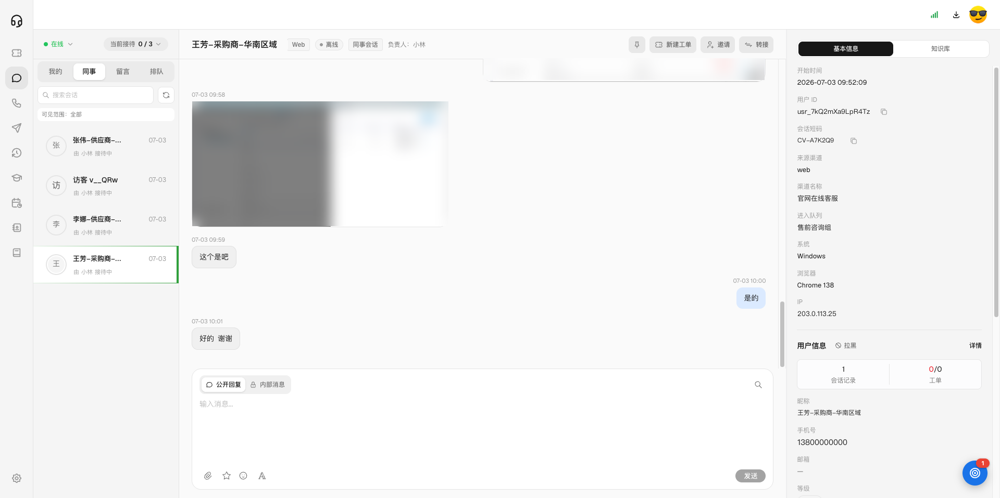
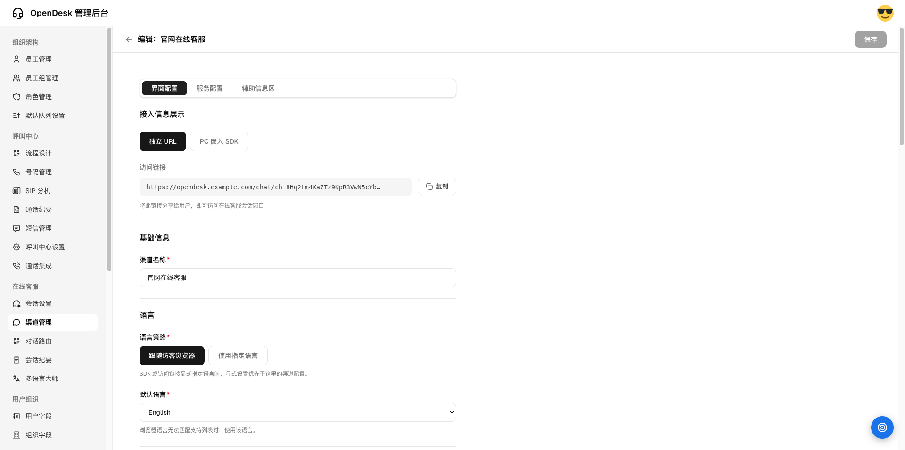
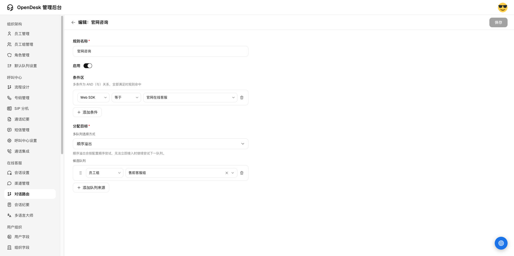
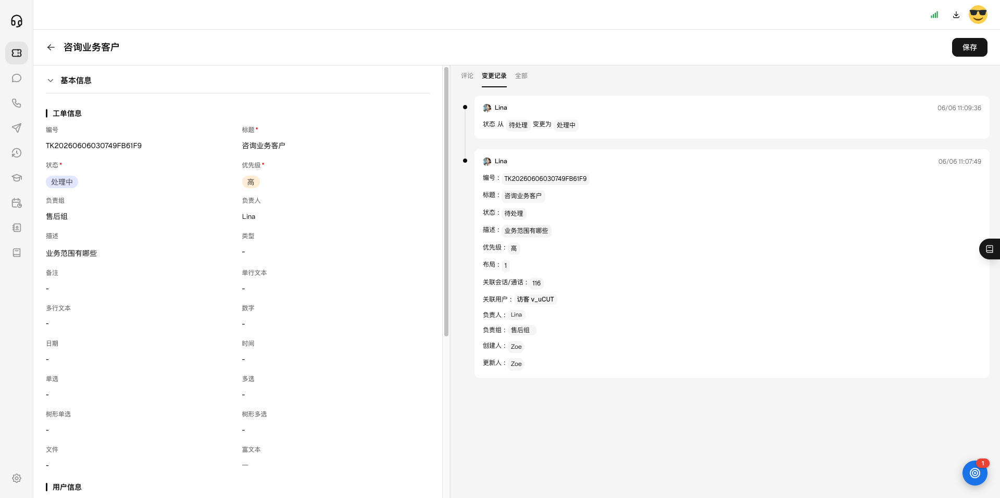
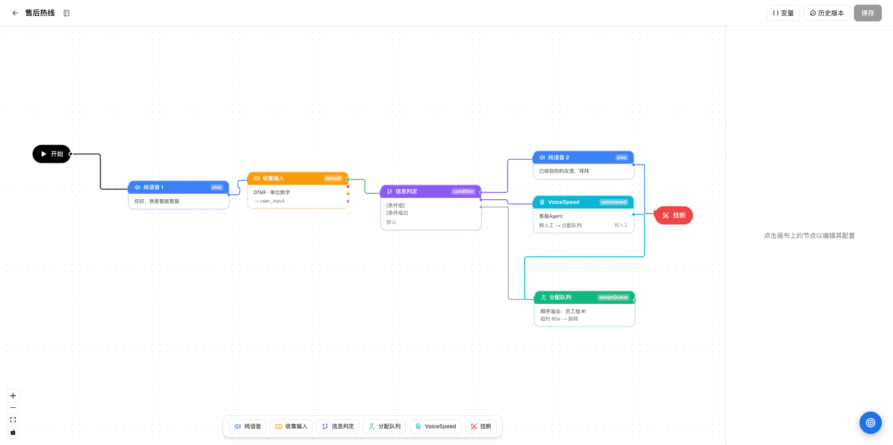
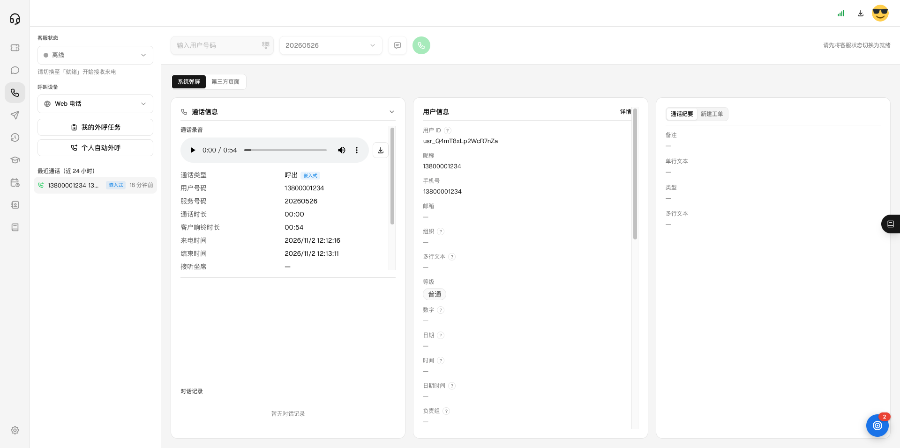
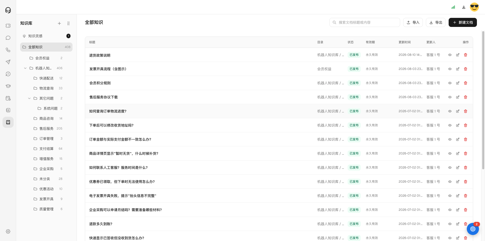
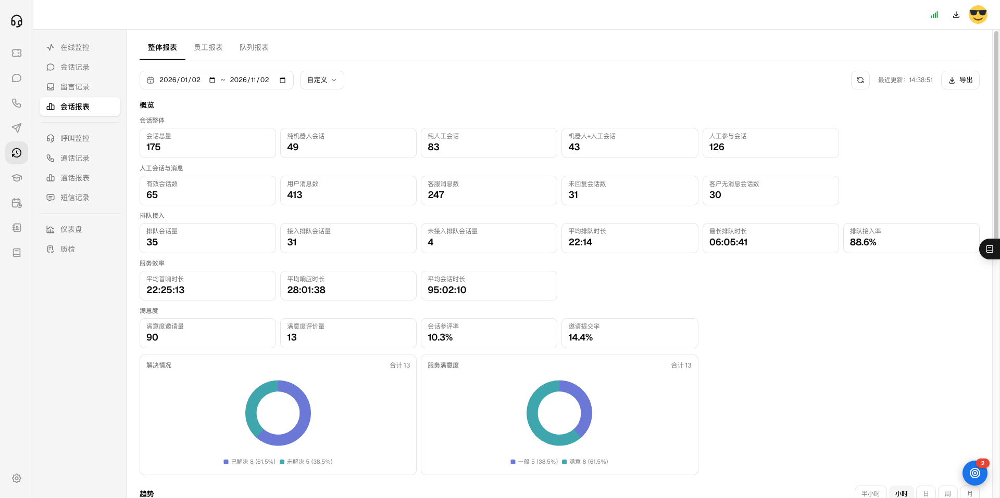
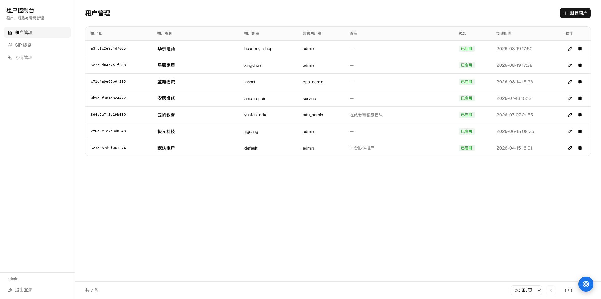

<div align="center">

# OpenDesk

**开源的全渠道客服与工单平台**：在线客服、呼叫中心、工单、知识库、服务运营，一套系统，私有化部署。

<p align="center">
  <a href="https://openagent.deepflowagent.com/hc/helpcenter/t/opendesk-doc/Open%20Desk.md">产品介绍</a> ·
  <a href="https://www.deepflowagent.com/">深流 AI 官网</a> ·
  <a href="./docker/README.md">自托管部署</a> ·
  <a href="https://hub.docker.com/r/deepflowagent/opendesk-api">Docker Hub</a> ·
  <a href="https://github.com/DeepFlowAI/OpenDesk/issues">反馈问题</a>
</p>

<p align="center">
  <a href="LICENSE"></a>
  <a href="https://hub.docker.com/r/deepflowagent/opendesk-api"></a>
  <a href="https://hub.docker.com/r/deepflowagent/opendesk-web"></a>
  <a href="https://github.com/DeepFlowAI/OpenDesk/releases"></a>
  <a href="https://github.com/DeepFlowAI/OpenDesk/stargazers"></a>
</p>

</div>

<p align="center"></p>

## OpenDesk 是什么

OpenDesk 是面向企业与服务商的客服与工单一体化平台，由 [深流 AI](https://www.deepflowagent.com/) 开发并开源。

管理员在**管理后台**配置渠道、路由规则、工单和用户字段；一线客服在**客服工作台**接待网页会话和电话，维护客户档案，把一时解决不了的问题落成工单继续跟进。字段、布局、视图和流程都能在后台调整，业务变了不用每次改代码。

开源版与官方云服务使用同一套内核，可以完全私有化部署，代码可审计、可二次开发。

**适合谁用**

- 在官网、App 或内嵌门户提供在线客服，希望按渠道、时段和规则分流会话的团队
- 需要协作接待、知识库推荐、质检复盘和工单闭环的售前、售后组织
- 同时维护个人与公司档案，并希望接入呼叫中心的 B2B 服务团队
- 需要一套可私有化、可二次开发客服底座的 ISV、集成商和企业研发团队

## ✨ 核心能力

### 在线客服工作台

会话列表按"我的 / 协作 / 同事 / 排队 / 留言"分组；支持富文本消息、引用与撤回、会话置顶、转接、邀请协作；接待中可直接编辑客户档案、填写会话纪要、新建工单；右侧辅助区可嵌入自定义页面。

### 渠道与路由

Web SDK 支持独立链接和网页嵌入，可配置窗口外观、欢迎语、公告、满意度调查、排队提示和留言；按服务时间、条件和员工组把会话分配给合适的队列；可接入 OpenAgent 机器人先行接待。

<table>
  <tr>
    <td width="50%"></td>
    <td width="50%"></td>
  </tr>
  <tr>
    <td align="center">Web SDK 渠道配置</td>
    <td align="center">对话路由：按条件分配到员工组</td>
  </tr>
</table>

### 工单

共享字段池、工单布局、工单视图、工单流程全部可配置；客服在工作台一键建单，在工单工作台按视图处理和导出。

<p align="center"></p>

### 呼叫中心

可视化语音流程设计（IVR、路由、满意度流程）、号码管理、通话纪要；坐席在浏览器里接听和外呼，通话中可发短信；提供呼叫监控、通话记录与通话报表。通过 SIP 线路对接运营商。

<table>
  <tr>
    <td width="50%"></td>
    <td width="50%"></td>
  </tr>
  <tr>
    <td align="center">可视化语音流程设计</td>
    <td align="center">呼叫中心工作台：通话信息与录音</td>
  </tr>
</table>

### 知识库

目录与文档管理、导入导出；接待时根据对话智能推荐答案；客服可以把对话中的好回答收进"知识灵感"，审核后入库。

<p align="center"></p>

### 服务运营

在线监控、会话记录（可自定义列、查看接待轨迹）、会话与队列报表、自定义看板、会话质检（AI 或人工评分），异步导出统一在导出任务中下载。

<p align="center"></p>

### 租户控制台

平台管理员在 `/tenant` 管理租户（新建、编辑、启用停用）、SIP 线路和号码：配置运营商对端地址，把号码绑定到租户，设置并发数和外呼时段，支持批量编辑和导出。一套部署即可服务多个租户。

<p align="center"></p>

### 更多

- **触达中心**：人工 / 自动外呼任务、外呼话术、短信群发
- **学习中心**：在线课程与考试
- **排班中心**：班次、排班表、我的排班
- **Open API**：用 API Key 接入客户上下文、知识库、外呼任务、通话事件与录音

完整功能说明见 [OpenDesk 产品介绍](https://openagent.deepflowagent.com/hc/helpcenter/t/opendesk-doc/Open%20Desk.md)。

## 🚀 快速开始

```bash
git clone https://github.com/DeepFlowAI/OpenDesk.git
cd OpenDesk/docker
cp .env.example .env
python -c "import secrets; print('SECRET_KEY=' + secrets.token_hex(32))" >> .env
# 在 .env 里填写 DEFAULT_ADMIN_PASSWORD（首个管理员的密码，必填）

docker compose up -d        # 默认自带 PostgreSQL + Redis
```

打开 <http://localhost:3000>，使用以下账号登录：

| 字段     | 值                                  |
| -------- | ----------------------------------- |
| 企业 ID  | `default`                           |
| 账号     | `admin`                             |
| 密码     | `.env` 里设置的 `DEFAULT_ADMIN_PASSWORD` |

> ⚠️ 生产环境首次启动时，管理员密码为空或仍是文档里的示例值会拒绝创建管理员。登录接口对同一账号连续输错 10 次会锁定 15 分钟。

### 开启租户控制台

在 `.env` 里设置 `TENANT_CONSOLE_PASSWORD`（用户名默认 `admin`，可用 `TENANT_CONSOLE_USERNAME` 修改），重启后访问 <http://localhost:3000/tenant>。密码留空时控制台保持关闭。

### 使用自己的数据库 / Redis

编辑 `.env` 里的 `COMPOSE_PROFILES=` 排除对应内嵌服务，再设置 `DATABASE_URL` / `REDIS_URL`，命令仍然是 `docker compose up -d`。完整部署指南（4 种模式 · 生产清单 · nginx 反代 · 备份）见 **[docker/README.md](docker/README.md)**。

## 🛠️ 本地开发

```bash
# 后端
cd server && python -m venv venv && source venv/bin/activate
pip install -r requirements.txt
cp .env.example .env.dev   # 修改 DATABASE_URL / REDIS_URL 指向本地实例
uvicorn app.main:app --reload --port 5001

# 前端
cd web && npm install
cp .env.example .env.dev
npm run dev
```

| 服务               | 地址                       |
| ------------------ | -------------------------- |
| 前端               | http://localhost:3000      |
| 后端 API           | http://localhost:5001      |
| API 文档 (Swagger) | http://localhost:5001/docs |

## 🧭 页面路由

| 分组 | 路由 |
| --- | --- |
| **登录** | `/login` · `/login/forgot-password` |
| **管理后台** | `/employees` · `/employee-groups` · `/flow-studio` · `/channels` · `/session-routing` · `/service-hours` · `/system-settings` |
| **客服工作台** | `/workspace/chat` · `/workspace/call` · `/workspace/tickets` · `/workspace/knowledge` · `/workspace/records` |
| **学习 / 排班** | `/learning` · `/scheduling` |
| **租户控制台** | `/tenant` · `/tenant/sip-trunks` · `/tenant/phone-numbers` |

## 🧩 架构

```
┌─────────────────────────┐    ┌─────────────────────────┐
│  Next.js 15 + React 19  │◄──►│   FastAPI + Socket.IO   │
│  (web)                  │    │   (api)                 │
└─────────────────────────┘    └────────────┬────────────┘
                                            │
                          ┌─────────────────┼─────────────────┐
                          ▼                 ▼                 ▼
                  ┌──────────────┐  ┌──────────────┐  ┌──────────────┐
                  │ PostgreSQL 15│  │   Redis 7    │  │   对象存储   │
                  │ (业务数据)   │  │ (缓存+发布)  │  │  (文件上传)  │
                  └──────────────┘  └──────────────┘  └──────────────┘
```

后端严格遵循 **Router → Service → Repository → Model** 分层，输入输出由 Pydantic Schema 约束。租户、电话、短信、报表等业务模块放在 `server/app/extensions/`，由约定式加载器自动注册。

## 🤝 贡献

欢迎提交 Issue、Discussion 与 Pull Request。提交 PR 前请确保测试通过：

```bash
cd server && pytest
```

## 🏢 关于深流 AI

OpenDesk 由北京深流智海科技有限公司（深流 AI）开发和维护。我们同时提供 OpenDesk 云服务、企业智能体平台 OpenAgent，以及私有化部署与定制服务。

- 产品介绍：<https://openagent.deepflowagent.com/hc/helpcenter/t/opendesk-doc/Open%20Desk.md>
- 公司官网：<https://www.deepflowagent.com/>

## 📜 协议

OpenDesk 采用 [GNU Affero 通用公共许可证 v3.0](LICENSE) 开源。
